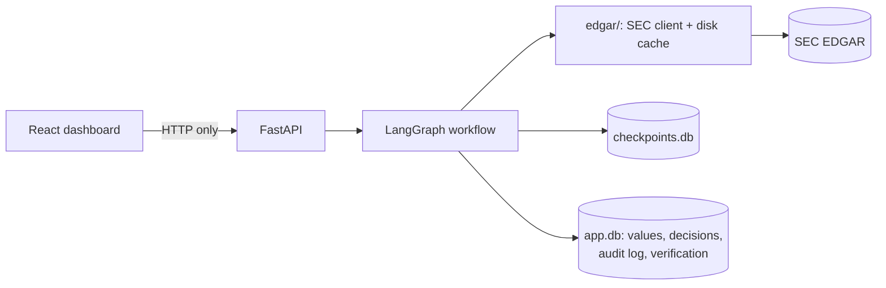

# AuditLoop

**A human-in-the-loop agent that audits SEC 10-K filings.** It reads the financial statements the way an analyst would, approves the numbers it is sure about, pauses for a human on the ones it isn't, and grades itself against the SEC's XBRL data.

**MineArena 1.0 · PS-01 Financial Filing Auditor · Code Commit, BIET Davangere · 12–13 Nov 2026**

| Accuracy vs XBRL | Wrong auto-approvals | Metrics per filing | Unseen companies | Tests |
|---|---|---|---|---|
| **96.6%** (56/58) | **0** | **13** | **98/102** correct | **23** unit · **24/24** end-to-end |

Full write-up: [project report (PDF)](docs/AuditLoop_Project_Report.pdf) · [Word](docs/AuditLoop_Project_Report.docx)

---

## What it does

1. **Fetches** the latest 10-K for any US public company from SEC EDGAR (rate-limited, cached, works offline).
2. **Extracts** 13 metrics from the filed HTML tables, with the inline-XBRL tags stripped so it can't read the answer key. Two extractors read every table independently: a rule-based parser and an LLM that must quote the exact row.
3. **Scores** each value: `0.45 × extractor agreement + 0.30 × label match + 0.25 × period/unit`.
4. **Validates** the numbers: Assets = Liabilities + Equity, segment sum, year-on-year change, scale, units, signs, tie-outs, auditor's opinion.
5. **Decides:** auto-approves a value only if confidence ≥ 0.85, the label matches and no check failed. Everything else is escalated with a plain-English reason.
6. **Pauses** for a reviewer, who sees the value, the score, every check and the original 10-K table, then approves, corrects or rejects.
7. **Resumes** from a saved checkpoint. Nothing is ever processed or recorded twice.
8. **Verifies** every value against SEC XBRL Company Facts and builds an accuracy report.
9. **Logs** every decision, human or automatic, in an append-only, hash-chained audit log.

**Metrics:** revenue, net income, total assets, total liabilities, shareholders' equity, operating cash flow, operating income, diluted EPS, cash, gross profit, capex, long-term debt, free cash flow.

## Results

Full run of all five demo companies, graded against XBRL:

| Company | Accuracy | What the reviewer sees |
|---|---|---|
| Apple (AAPL) | 100% | Clean filing; 5 geographic segments sum to revenue |
| Microsoft (MSFT) | 100% | Clean filing; only derived values go to a human |
| Walmart (WMT) | 100% | No total-liabilities line, so it's derived; A = L + E off by 2.2% (noncontrolling interest) |
| Nvidia (NVDA) | 91.7% | Revenue +65%, equity +98%: genuine year-on-year anomalies |
| Tesla (TSLA) | 91.7% | A = L + E off by 0.5% (noncontrolling interest): the live pause in the demo |

- **36 auto-approved, 29 escalated, 0 wrong auto-approvals.** Both misses went to a human.
- **Calibrated:** all 53 values scored above 0.85 were correct.
- **Generalises:** 98/102 correct on 9 companies the rules were never tuned on (JPM, PFE, COST, HD, AMZN, GOOGL, PG, KO, COCO), still with 0 wrong auto-approvals.
- **Reliable:** repeated full runs give identical results and 0 crashes.

## Problem statement coverage

| Requirement | Status |
|---|---|
| 3.1 SEC EDGAR integration (3–5 companies) | ✅ 5 demo companies, plus any US company from a search box |
| 3.2 Extraction (≥ 8 metrics, with period, unit and evidence) | ✅ 13 metrics, each with its source row |
| 3.3 Confidence scoring with a configurable threshold | ✅ |
| 3.4 Validation: A = L + E, segments, year-on-year | ✅ plus 10 more checks |
| 3.5 Human-in-the-loop: pause, show evidence, approve/correct/reject | ✅ |
| 3.6 Checkpointing, resume, no duplicate side effects | ✅ survives a server restart |
| 3.7 Reviewer dashboard | ✅ |
| 3.8 XBRL verification, accuracy report, append-only audit log | ✅ |
| Bonus: MCP tool integration | ✅ |
| Bonus: multi-period variance analysis with AI explanations | ✅ |
| Bonus: adaptive escalation thresholds | ✅ |

## Architecture



The workflow, step by step:

```
fetch_filing → locate_statements → extract → score_confidence → validate → route → auto_approve
    → [human_review ⇄ apply_decision]* → verify_vs_xbrl → build_report
```

- **Pause and resume:** `human_review` calls `interrupt()` and has no side effects. All writes happen in `apply_decision`, keyed by `decision_id = thread_id:value_id`, so a retry, double click or crash can't record anything twice.
- **No cheating:** XBRL Company Facts are fetched only in `verify/`. The MCP tool router blocks the XBRL tool during extraction.
- **Tamper-evident:** database triggers block UPDATE and DELETE on `audit_log`, and every row includes the previous row's hash.

**Stack:** Python 3.11 · LangGraph · FastAPI · SQLite · pandas · BeautifulSoup/lxml · rapidfuzz · Groq (`openai/gpt-oss-120b`, Gemini as backup) · Pydantic · React · TypeScript · Vite · Tailwind

## Quick start

```bash
git clone https://github.com/Srujanmirji/MINEARENA.git && cd MINEARENA
python -m venv .venv && source .venv/bin/activate      # Windows: .venv\Scripts\activate
pip install -r requirements.txt
cp .env.example .env                                    # add GROQ_API_KEY and SEC_USER_AGENT
```

Start the backend:

```bash
uvicorn api.main:app --port 8000
```

Start the dashboard (in a second terminal), then open http://localhost:5173:

```bash
cd ui/frontend && npm install && npm run dev
```

SEC and LLM responses for the demo companies are committed in `cache/`, so the demo runs without network access.

### Configuration (`.env`)

| Variable | Default | Purpose |
|---|---|---|
| `GROQ_API_KEY` / `GEMINI_API_KEY` | — | LLM keys; the other provider is the automatic backup |
| `LLM_PROVIDER` | `groq` | `groq` or `gemini` |
| `SEC_USER_AGENT` | — | Required by the SEC, e.g. `"AuditLoop Team you@example.com"` |
| `CONFIDENCE_THRESHOLD` | `0.85` | Auto-approve threshold (also adjustable live in the dashboard) |
| `YOY_THRESHOLD` | `0.40` | Year-on-year change that counts as an anomaly |

## Demo

Build the judging state in one command (stop the API first; old data is backed up to `data/backup-*`):

```bash
python -m verify.demo_setup --reset
```

This leaves AAPL, MSFT and NVDA finished, WMT paused with 5 items for the Correct and Reject moments, and TSLA ready to run live. The full script and judge Q&A are in [`docs/DEMO.md`](docs/DEMO.md).

## Testing

| Command | What it proves |
|---|---|
| `python -m unittest discover -s tests -v` | 23 unit tests: scoring, checks, extraction rules, audit log (no network) |
| `python -m api.test_flow` | 24 end-to-end checks: pause, resume, kill and restart, duplicate decisions, reports |
| `python -m verify.run_all` | Full graded runs of all 5 companies in a throwaway folder; prints the headline numbers |
| `python -m agent.mcp_tools --stdio` | Runs the MCP server (JSON-RPC over stdio) |

Every module also has a `__main__` self-test, e.g. `python -m scoring.validation`.

## Project structure

```
├── edgar/      SEC client and throttled disk cache                     (Mayur)
├── extract/    cleaning, statement locator, parser + LLM extractors,   (Mayur)
│               segments, tie-outs, auditor's opinion, MD&A explanations
├── scoring/    confidence, validation engine, approve-or-escalate      (Srujan)
├── verify/     XBRL verification, accuracy report, run_all, demo_setup (Srujan)
├── audit/      append-only, hash-chained audit log                      (Srujan)
├── agent/      LangGraph graph, nodes, MCP tool server                  (Zeeshan)
├── api/        FastAPI app and end-to-end test                          (Zeeshan)
├── core/       shared models, database, config                          (Zeeshan)
├── ui/         React reviewer dashboard (ui/frontend)                   (Sai)
├── tests/      unit tests
├── cache/      cached SEC + LLM responses (offline demo)
├── data/       SQLite databases (not committed), mock_values.json
└── docs/       PRD, architecture, API, data model, demo script, project report
```

## Team

| Person | GitHub | Role |
|---|---|---|
| Srujan Mirji | [`Srujanmirji`](https://github.com/Srujanmirji) | Team lead · scoring, validation, verification, audit log, docs, pitch |
| Zeeshan Madras | [`dharwadzishan-sys`](https://github.com/dharwadzishan-sys) | Agent and backend · LangGraph workflow, FastAPI, database |
| Mayur Habib | [`mayurhabib26-hub`](https://github.com/mayurhabib26-hub) | SEC data and extraction · EDGAR client, both extractors |
| Sai Sudheer | [`SaiSudhee2723`](https://github.com/SaiSudhee2723) | Frontend and UI/UX · landing page and reviewer dashboard |

## Documentation

| File | Contents |
|---|---|
| [`docs/AuditLoop_Project_Report.pdf`](docs/AuditLoop_Project_Report.pdf) | Project report: build, contributions, challenges and fixes, results |
| [`docs/PRD.md`](docs/PRD.md) | Product requirements |
| [`docs/ARCHITECTURE.md`](docs/ARCHITECTURE.md) | System design, LangGraph flow, idempotency rules |
| [`docs/DATA_MODEL.md`](docs/DATA_MODEL.md) | Pydantic schema, SQLite tables, XBRL tag map |
| [`docs/API.md`](docs/API.md) | API endpoints with request and response examples |
| [`docs/DEMO.md`](docs/DEMO.md) | 5-minute demo script and judge Q&A |
| [`CONTRIBUTING.md`](CONTRIBUTING.md) | Folder ownership and git rules |
