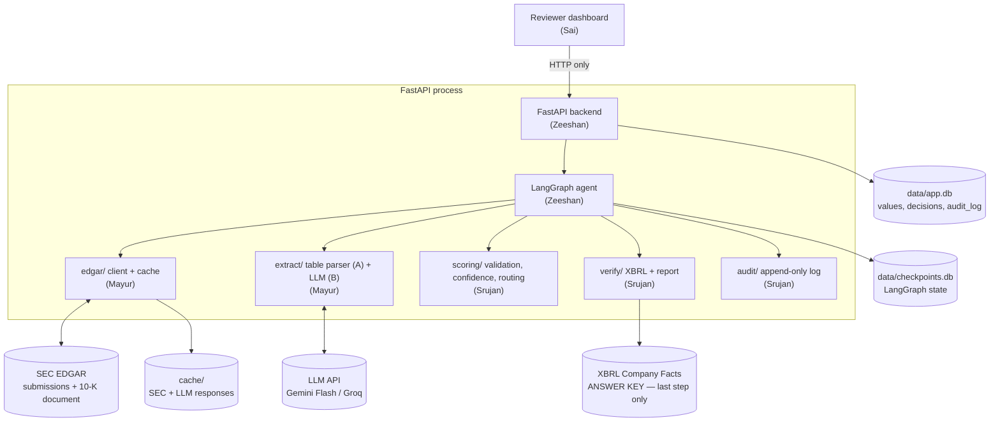
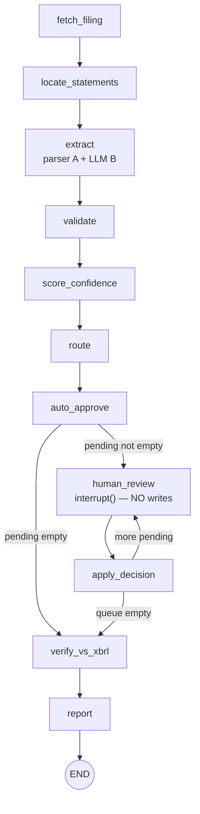
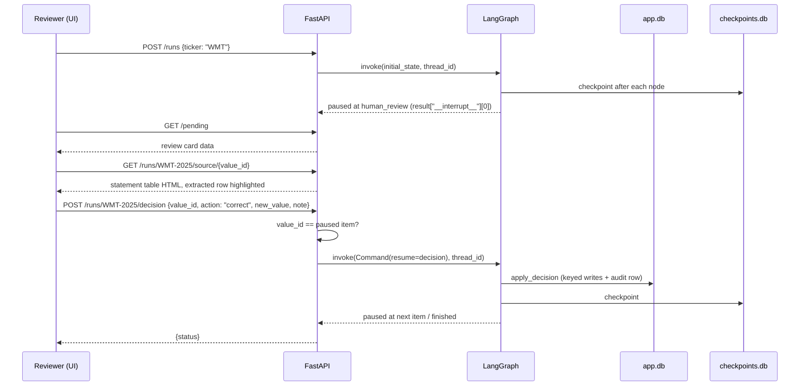

# Architecture — AuditLoop

The agent runs inside FastAPI. Streamlit is a thin client that only calls the API. Values are **extracted from the filed 10-K document** and **graded against XBRL Company Facts**, which is read only in the last step.

## 1. System diagram



## 2. Why this shape

| Decision | Reason |
|---|---|
| Extract from the **primary 10-K document**, not the R pages | SEC generates the R pages from XBRL, and their HTML carries XBRL tag names. Extracting from them invites "you read the XBRL viewer". The filed document is the original source evidence. |
| Strip inline-XBRL (`ix:`) tags before extracting | The 10-K HTML embeds XBRL tags; we keep only the visible text and numbers, so the extractor can't read concept names |
| Two independent extractors (parser A + LLM B) | Their agreement is the strongest confidence signal; either one alone still works (parser-only mode) |
| Graph runs in FastAPI, not the UI | Streamlit reruns on every click; a separate process also makes kill-and-restart possible |
| SQLite, two files | Zero setup. `checkpoints.db` belongs to LangGraph; `app.db` is ours. Triggers enforce append-only |
| XBRL isolated to `verify/` | It's the ground truth; using it earlier makes accuracy meaningless |
| Disk cache for everything external | Venue Wi-Fi; SEC rate limits; reproducible demo; no paying twice for LLM calls |

**Fallback (decided at 8 PM):** if locating statement tables in the primary document isn't reliable for at least 4 of 5 companies by the 8 PM checkpoint, switch the locator to R pages (via `FilingSummary.xml`) with the `defref_*` tag links stripped, and say so openly to judges.

## 3. LangGraph workflow



- One graph run = one filing. `thread_id = f"{ticker}-{fiscal_year}"`.
- **`validate` runs before `score_confidence`**, because the score includes a validation term.
- `route` splits values into "clean" and an ordered `pending` list (with reasons).
- `auto_approve` always runs: it approves the clean values, then a conditional edge checks `pending`.
- Each pause holds **one** value. The `human_review ↔ apply_decision` loop runs until `pending` is empty.

### Node table

| Node | Module (owner) | Reads | Writes to state | Side effects |
|---|---|---|---|---|
| `fetch_filing` | `edgar.client` (Mayur) | ticker | cik, accession, fiscal_year, period_end, primary_document | cache files (skipped if cached) |
| `locate_statements` | `extract.locate` (Mayur) | cleaned document | tables (statement → table index, heading, scale) | none |
| `extract` | `extract.extractor` (Mayur) | tables | values, segments | `INSERT OR IGNORE` values |
| `validate` | `scoring.validation` (Srujan) | values, segments | values (validation) | none |
| `score_confidence` | `scoring.confidence` (Srujan) | values | values (signals, confidence) | none |
| `route` | `scoring.router` (Srujan) | values, threshold | values (status, reason), pending | none |
| `auto_approve` | `agent.nodes` (Zeeshan) | values | — | idempotent status update + audit rows (`system`) |
| `human_review` | `agent.nodes` (Zeeshan) | pending[0] | decision | **none** |
| `apply_decision` | `agent.nodes` (Zeeshan) | decision | pending (popped), values | idempotent decision + audit row |
| `verify_vs_xbrl` | `verify.xbrl` (Srujan) | values, Company Facts | verification | `verification` rows |
| `report` | `verify.report` (Srujan) | everything | report | `run_reports` row |

### Graph state

```python
class AuditState(TypedDict):
    ticker: str
    cik: str
    accession: str
    fiscal_year: int
    period_end: str                 # "2024-09-28"
    primary_document: str           # "aapl-20240928.htm"
    tables: dict[str, dict]         # {"balance_sheet": {"index": 41, "heading": "...", "scale": 1000000}, ...}
    values: list[dict]              # ExtractedValue.model_dump() — dicts serialize cleanly in checkpoints
    segments: list[dict]            # [{"segment": "Americas", "value": 167045.0}]
    pending: list[str]              # value ids awaiting review, in order
    decision: dict | None           # set by human_review, consumed by apply_decision
    threshold: float
    report: dict | None
```

## 4. Pause / resume — the rules that win criterion 5

LangGraph re-runs **the whole node** that called `interrupt()` when the graph resumes. Anything before `interrupt()` in that node runs twice.

```python
from langgraph.types import interrupt, Command

def human_review(state: AuditState):
    vid = state["pending"][0]
    item = next(v for v in state["values"] if v["id"] == vid)
    decision = interrupt({"value": item, "reason": item["escalation_reason"]})   # NO side effects before this
    return {"decision": decision}                                                  # nothing else in this node

def apply_decision(state: AuditState):
    d = state["decision"]
    d["decision_id"] = f"{d['thread_id']}:{d['value_id']}"     # deterministic idempotency key
    db.record_decision(d)                                      # INSERT OR IGNORE on decision_id
    audit.append(d)                                            # UNIQUE(decision_id) → no-op on replay
    db.set_final(d["value_id"], d["action"], d.get("new_value"))
    return {"pending": state["pending"][1:], "decision": None}
```

1. **One `interrupt()` per node, one value per pause.** No `while True` loops around `interrupt()`.
2. **Never wrap `interrupt()` in a bare `try/except`.** It pauses by raising; a bare except swallows the pause.
3. **Every write is keyed:** `extracted_values.id` and `decision_id = thread_id:value_id` with UNIQUE constraints.
4. **`/decision` checks** that `value_id` equals the currently paused item; otherwise HTTP 409.
5. **`fetch_filing` and LLM calls check the cache first**, so a replay never downloads or pays twice.
6. **On API startup**, scan known thread ids, call `graph.get_state(config)`, and mark threads waiting at `human_review` as paused.

### Checkpointer setup

```python
import sqlite3
from langgraph.checkpoint.sqlite import SqliteSaver

conn = sqlite3.connect("data/checkpoints.db", check_same_thread=False)
graph = build_graph().compile(checkpointer=SqliteSaver(conn))
```

### Review sequence



## 5. Extraction

| Step | Module | What |
|---|---|---|
| Fetch | `edgar.client` | Latest 10-K from Submissions → `primaryDocument` → download `Archives/edgar/data/{int(cik)}/{accession_no_dashes}/{primaryDocument}` |
| Clean | `extract.clean` | Unwrap every `ix:*` tag (keep its text), drop `ix:header` and hidden (`display:none`) blocks |
| Locate | `extract.locate` | Find "CONSOLIDATED BALANCE SHEETS", "…STATEMENTS OF OPERATIONS / INCOME / EARNINGS", "…STATEMENTS OF CASH FLOWS", segment note; take the next numeric `<table>`; read scale from "(In millions…)" |
| Extractor A | `extract.table_parser` | `pandas.read_html` → rapidfuzz row match vs SYNONYMS → current-year column |
| Extractor B | `extract.llm_extractor` | Table as text → LLM strict JSON (value, row_label, column_header, snippet). **Reject any answer whose snippet isn't found word-for-word in the table** |
| Combine | `extract.extractor` | `value` = B if its snippet verified, else A; `alt_value` = the other one; `extractor` = which was used |

**Parser-only mode:** if the LLM is down or rate-limited, run A alone. The agreement signal becomes 0.5, so more values escalate, but the flow still works.

## 6. Validation (runs first)

| Rule | Check | Severity |
|---|---|---|
| Accounting equation | \|A − (L + E)\| / A ≤ 0.5%; if it fails, retry with equity incl. NCI before flagging | Hard |
| Segment sum | Σ segment revenue = reported revenue within 0.5% (from the segment note); "N/A" if no segment table | Hard when available |
| Year-on-year | \|change\| > 40% vs prior-year column → anomaly | Soft |
| Scale sanity | value ≈ 1,000× (or ÷1,000) the prior year → "possible scale error" | Hard |
| Sign | revenue, total assets, total liabilities > 0; brackets read as negatives | Hard |

## 7. Confidence (runs after validation)

**C = 0.35·A + 0.25·L + 0.20·P + 0.20·V**

| Part | 1.0 | 0.5 | 0 |
|---|---|---|---|
| **A** agreement | parser and LLM match within 1 unit of scale | only one extractor found a value | they disagree |
| **L** label | rapidfuzz score of row label vs synonyms (0–1, continuous) | | |
| **P** period + unit | column date = fiscal year end **and** scale detected | one of the two | neither |
| **V** validation | every check on this value passed (N/A counts as pass) | | any check failed |

Derived values (e.g. liabilities = L&E − equity) are **capped at 0.75**, so they always reach a human.

**Routing:** auto-approve iff value present **and** C ≥ threshold **and** no failed check of any severity. The PS requires a pause whenever a validation check fails, so this must hold even when someone lowers the threshold slider below 0.80. Severity only changes the badge and reason text: hard = "possible error", soft = "anomaly".

## 8. Storage

| File | Owner | Contents |
|---|---|---|
| `data/checkpoints.db` | LangGraph | Graph checkpoints. Never edit by hand. |
| `data/app.db` | Zeeshan (schema), everyone via `core/db.py` | `filings`, `extracted_values`, `review_decisions`, `audit_log`, `verification`, `run_reports`, `config` |
| `cache/sec/` | Mayur | Raw SEC JSON / HTML keyed by URL hash |
| `cache/llm/` | Mayur | LLM responses keyed by sha256(prompt) |

Full DDL in [`DATA_MODEL.md`](DATA_MODEL.md).

## 9. Module interfaces (the contract)

```python
# edgar/client.py — Mayur
def get_cik(ticker: str) -> str                                   # "0000320193"
def get_latest_10k(cik: str) -> dict                              # {accession, fiscal_year, period_end, filing_date, primary_document}
def get_primary_doc(cik: str, accession: str, primary_document: str) -> str   # raw HTML (cached)
def get_company_facts(cik: str) -> dict                           # ONLY verify/ may call this

# extract/ — Mayur
def strip_ixbrl(html: str) -> str                                 # extract/clean.py
def locate_statements(clean_html: str) -> dict[str, dict]         # extract/locate.py → {"balance_sheet": {"index","heading","scale","html"}, ...}
def extract_filing(meta: dict, tables: dict[str, dict]) -> tuple[list[ExtractedValue], list[dict]]   # extract/extractor.py → (values, segments)
def get_table_html(meta: dict, table_index: int) -> str           # for the API's source-evidence endpoint

# scoring/ — Srujan
def validate_filing(values: list[ExtractedValue], segments: list[dict], cfg: dict) -> list[ExtractedValue]   # validation.py
def score_values(values: list[ExtractedValue], period_end: str) -> list[ExtractedValue]                     # confidence.py
def route(values: list[ExtractedValue], threshold: float) -> tuple[list[ExtractedValue], list[str]]          # router.py

# verify/ — Srujan
def verify_values(values: list[ExtractedValue], facts: dict, accession: str) -> list[dict]   # xbrl.py
def build_report(thread_id: str | None = None) -> dict                                       # report.py

# audit/log.py — Srujan
def init_tables(conn) -> None
def append(entry: dict) -> dict        # idempotent on decision_id; returns the stored row
def list_rows(limit: int = 200) -> list[dict]
def verify_chain() -> dict             # {"ok": bool, "rows": n, "broken_at_seq": int | None}

# core/db.py — Zeeshan
def init_db() -> None
def upsert_values(values: list[ExtractedValue]) -> None    # INSERT OR IGNORE
def set_status(value_id: str, status: str, final_value: float | None, reason: str | None = None) -> None
def record_decision(d: dict) -> bool                       # False if decision_id already exists
```

If you need to change one of these signatures, post in the group first.
