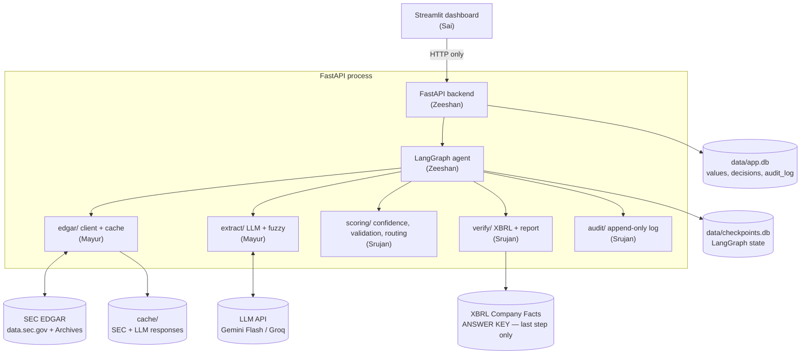
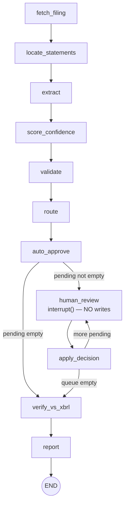
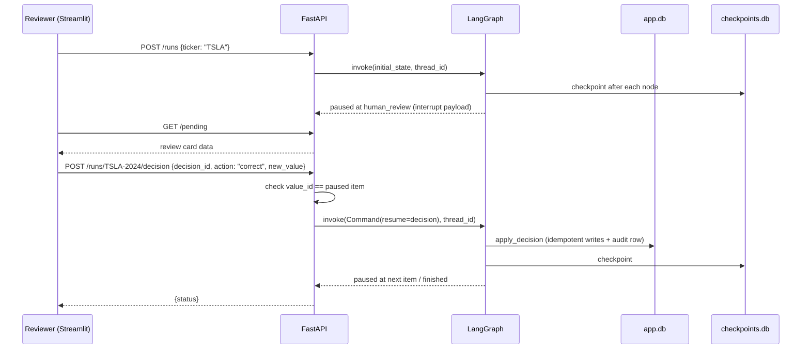

# Architecture — AuditLoop

The agent runs inside FastAPI. Streamlit is a thin client that only calls the API. XBRL Company Facts is read **only** in the last step.

## 1. System diagram



## 2. Why this shape

| Decision | Reason |
|---|---|
| Graph runs in FastAPI, not Streamlit | Streamlit reruns the whole script on every click, so it would start duplicate runs. A separate process also makes the kill-and-restart demo possible. |
| SQLite, two files | Zero setup. `checkpoints.db` belongs to LangGraph; `app.db` is ours. Triggers enforce append-only. |
| Statement pages (`R*.htm`), not the full 10-K | Small tables, LLM-friendly, and the row text is natural "source evidence". |
| Deterministic confidence signals | LLM self-reported confidence is poorly calibrated. Signals are explainable on the review card. |
| XBRL isolated to `verify/` | It's the ground truth. Using it earlier makes accuracy meaningless. |
| Disk cache for everything external | Venue Wi-Fi; SEC rate limits; reproducible demo. |

## 3. LangGraph workflow



- One graph run = one filing. `thread_id = f"{ticker}-{fiscal_year}"`.
- `route` splits values into "clean" and an ordered `pending` list (with reasons).
- `auto_approve` always runs: it approves the clean values, then a conditional edge checks `pending`.
- Each pause holds **one** value. The `human_review ↔ apply_decision` loop runs until `pending` is empty.

### Node table

| Node | Module (owner) | Reads | Writes to state | Side effects |
|---|---|---|---|---|
| `fetch_filing` | `edgar.client` (Mayur) | ticker | cik, accession, fiscal_year, period_end | cache files |
| `locate_statements` | `edgar.locator` (Mayur) | FilingSummary | pages | none |
| `extract` | `extract.extractor` (Mayur) | pages | values, segments | `INSERT OR IGNORE` values |
| `score_confidence` | `scoring.confidence` (Srujan) | values | values (signals, confidence) | none |
| `validate` | `scoring.validation` (Srujan) | values, segments | values (validation) | none |
| `route` | `scoring.router` (Srujan) | values, threshold | values (status, reason), pending | none |
| `auto_approve` | `agent.nodes` (Zeeshan) | values | — | idempotent status update + audit rows (`system`) |
| `human_review` | `agent.nodes` (Zeeshan) | pending[0] | decision | **none** |
| `apply_decision` | `agent.nodes` (Zeeshan) | decision | pending (popped), values | idempotent decision + audit row |
| `verify_vs_xbrl` | `verify.xbrl` (Srujan) | values, Company Facts | verification | `verification` rows |
| `report` | `verify.report` (Srujan) | everything | report | `run_reports` row |

### Graph state

```python
class AuditState(TypedDict):
    ticker: str
    cik: str
    accession: str
    fiscal_year: int
    period_end: str                 # "2024-09-28"
    pages: dict[str, str]           # {"balance_sheet": "R5.htm", "income_statement": "R3.htm", ...}
    values: list[dict]              # ExtractedValue.model_dump() — dicts serialize cleanly in checkpoints
    segments: list[dict]            # [{"segment": "Americas", "value": 167045.0, "scale": 1e6}]
    pending: list[str]              # value ids awaiting review, in order
    decision: dict | None           # set by human_review, consumed by apply_decision
    threshold: float
    report: dict | None
```

Store `values` as plain dicts in state (not Pydantic objects) so the SQLite checkpointer serializes them without surprises.

## 4. Pause / resume — the rules that win criterion 5

LangGraph re-runs **the whole node** that called `interrupt()` when the graph resumes. Anything before `interrupt()` in that node runs twice.

```python
from langgraph.types import interrupt, Command

def human_review(state: AuditState):
    vid = state["pending"][0]
    item = next(v for v in state["values"] if v["id"] == vid)
    decision = interrupt({"value": item, "reason": item["escalation_reason"]})
    return {"decision": decision}                 # nothing else in this node

def apply_decision(state: AuditState):
    d = state["decision"]
    db.record_decision(d)                         # INSERT OR IGNORE on decision_id
    audit.append(d)                               # no-op if decision_id already logged
    db.set_final(d["value_id"], d["action"], d.get("new_value"))
    return {"pending": state["pending"][1:], "decision": None}
```

1. **One `interrupt()` per node, one value per pause.**
2. **Every write is keyed:** `extracted_values.id`, `review_decisions.decision_id`, `audit_log.decision_id UNIQUE`.
3. **`/decision` checks** that `value_id` equals the currently paused item; otherwise HTTP 409.
4. **`INSERT OR IGNORE`** for extraction rows, so replaying `extract` after a crash adds nothing.
5. **On API startup**, scan known thread ids, call `graph.get_state(config)`, and mark threads with `state.next == ("human_review",)` as paused.

### Checkpointer setup

```python
import sqlite3
from langgraph.checkpoint.sqlite import SqliteSaver

conn = sqlite3.connect("data/checkpoints.db", check_same_thread=False)
saver = SqliteSaver(conn)                 # NOT SqliteSaver.from_conn_string(...) — that's a context manager
graph = builder.compile(checkpointer=saver)
```

### Review sequence



## 5. Confidence scoring

| Signal | Weight | 1.0 when |
|---|---|---|
| `verbatim` | 0.30 | Extracted number appears in the source row text |
| `label` | 0.25 | Row label matches metric synonyms (rapidfuzz ratio / 100) |
| `scale` | 0.15 | Unit/scale found in the table header |
| `period` | 0.15 | Column date equals the filing's period end |
| `agreement` | 0.15 | Fuzzy-row value equals the LLM value |

`confidence = Σ weight × signal`. Derived values get `verbatim = 0`, so they escalate.

## 6. Validation

| Check | Rule | On fail, escalate |
|---|---|---|
| Accounting equation | \|A − (L + E)\| / A ≤ 0.5%; retry with equity incl. NCI | assets, liabilities, equity |
| Segment sum | \|Σ segments − revenue\| / revenue ≤ 0.5% | revenue |
| Year-on-year | \|cur − prior\| / \|prior\| > 30% | that metric (anomaly) |

## 7. Storage

| File | Owner | Contents |
|---|---|---|
| `data/checkpoints.db` | LangGraph | Graph checkpoints. Never edit by hand. |
| `data/app.db` | Zeeshan (schema), everyone (via `core/db.py`) | `filings`, `extracted_values`, `review_decisions`, `audit_log`, `verification`, `run_reports`, `config` |
| `cache/sec/` | Mayur | Raw SEC JSON / XML / HTML keyed by URL hash |
| `cache/llm/` | Mayur | LLM responses keyed by sha256(prompt) |

Full DDL in [`DATA_MODEL.md`](DATA_MODEL.md).

## 8. Module interfaces (the contract)

```python
# edgar/client.py — Mayur
def get_cik(ticker: str) -> str                                   # "0000320193"
def get_latest_10k(cik: str) -> dict                              # {accession, fiscal_year, period_end, filing_date}
def get_filing_summary(cik: str, accession: str) -> list[dict]    # [{"file": "R5.htm", "name": "CONSOLIDATED BALANCE SHEETS"}]
def get_page_html(cik: str, accession: str, file: str) -> str
def get_company_facts(cik: str) -> dict                           # ONLY verify/ may call this

# edgar/locator.py — Mayur
def locate_statements(summary: list[dict]) -> dict[str, str]      # keys: balance_sheet, income_statement, cash_flow, segment?

# extract/extractor.py — Mayur
def extract_filing(meta: dict, pages: dict[str, str]) -> tuple[list[ExtractedValue], list[dict]]  # (values, segments)

# scoring/confidence.py — Srujan
def score_values(values: list[ExtractedValue], period_end: str) -> list[ExtractedValue]
# scoring/validation.py — Srujan
def validate_filing(values: list[ExtractedValue], segments: list[dict], yoy_threshold: float) -> list[ExtractedValue]
# scoring/router.py — Srujan
def route(values: list[ExtractedValue], threshold: float) -> tuple[list[ExtractedValue], list[str]]   # (values with status+reason, pending ids)

# verify/xbrl.py — Srujan
def verify_values(values: list[ExtractedValue], facts: dict, accession: str) -> list[dict]
# verify/report.py — Srujan
def build_report(thread_id: str | None = None) -> dict

# audit/log.py — Srujan
def append(entry: dict) -> dict        # idempotent on decision_id; returns the stored row
def list_rows(limit: int = 200) -> list[dict]
def verify_chain() -> dict             # {"ok": bool, "rows": n, "broken_at_seq": int | None}

# core/db.py — Zeeshan
def init_db() -> None
def upsert_values(values: list[ExtractedValue]) -> None    # INSERT OR IGNORE
def set_status(value_id: str, status: str, final_value: float | None, reason: str | None = None) -> None
def record_decision(d: dict) -> bool                       # False if decision_id already exists
```

If you need to change one of these signatures, post in the group first.
